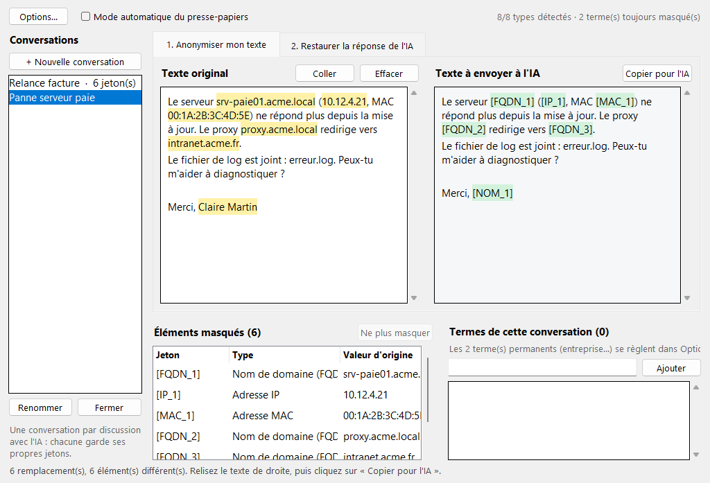
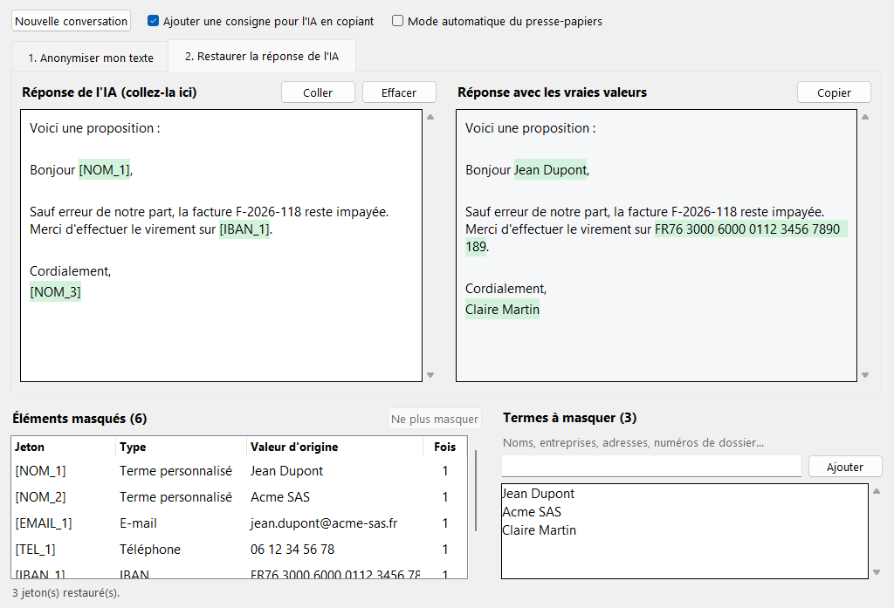

# IA-Anonymiser

Masquez vos données personnelles avant de les envoyer à une IA (Claude, ChatGPT…), puis remettez les vraies valeurs dans sa réponse, en un clic.



## Télécharger

Téléchargez **IA-Anonymiser.exe** dans la [dernière release](https://github.com/Some0neElseIsHere/IA-Anonymiser/releases/latest). Aucune installation n'est nécessaire : lancez simplement le fichier.

> Au premier lancement, Windows peut afficher « Windows a protégé votre ordinateur », car l'exe n'est pas signé. Cliquez sur **Informations complémentaires**, puis **Exécuter quand même**.

## Utilisation

1. **Onglet « Anonymiser mon texte »** : collez votre texte à gauche. La version anonymisée apparaît aussitôt à droite. Les éléments masqués sont surlignés en jaune.
2. Cliquez sur **Copier pour l'IA** et collez le texte dans votre conversation.
3. **Onglet « Restaurer la réponse de l'IA »** : collez la réponse de l'IA à gauche. À droite, les jetons comme `[NOM_1]` sont remplacés par les vraies valeurs. Cliquez sur **Copier**.



### Ce qui est masqué

- **Automatiquement** : e-mails, téléphones (France et international), IBAN, cartes bancaires, numéros de sécurité sociale, adresses IP.
- **Vos termes** : noms, entreprises, adresses, numéros de dossier… Ajoutez-les dans la liste « Termes à masquer », ou sélectionnez un mot dans le texte puis faites clic droit → **Masquer** (ou **Ctrl+M**). La liste est enregistrée et resservira à chaque lancement.

Le tableau « Éléments masqués » montre chaque élément remplacé. Double-cliquez sur une ligne pour le laisser en clair, ou pour le masquer à nouveau.

### Options

- **Ajouter une consigne pour l'IA en copiant** : ajoute une phrase demandant à l'IA de garder les jetons tels quels. Elle est activée par défaut, ce qui rend la restauration plus fiable.
- **Mode automatique du presse-papiers** : tout texte que vous copiez est anonymisé, et toute réponse contenant des jetons est restaurée, directement dans le presse-papiers. Attention : ce mode s'applique à *tout* ce que vous copiez tant qu'il est activé.
- **Nouvelle conversation** : oublie les correspondances en cours et fait repartir les jetons de 1. Vos termes sont conservés.

## Confidentialité

- Tout se passe sur votre ordinateur : l'application n'envoie rien sur Internet.
- Les correspondances entre jetons et vraies valeurs restent en mémoire et disparaissent à la fermeture. Gardez l'application ouverte pendant toute la conversation avec l'IA.
- Seule la liste de vos termes est enregistrée, dans `%APPDATA%\IA-Anonymiser\termes.txt`.

## Limites

La détection repose sur des motifs. Elle ne reconnaît pas un nom qui ne figure pas dans vos termes, et une adresse postale doit être ajoutée comme terme. **Relisez toujours le texte de droite avant de l'envoyer.**

Si l'IA modifie un jeton au point de le rendre méconnaissable, ou si elle en invente un, il reste tel quel et apparaît en rouge dans l'onglet Restaurer.

## Vérifier le téléchargement

Chaque release contient un fichier `SHA256SUMS.txt`. Dans PowerShell :

```
Get-FileHash .\IA-Anonymiser.exe -Algorithm SHA256
```

L'empreinte affichée doit correspondre à celle du fichier.

## Publier une nouvelle version

Dans l'onglet **Actions**, ouvrez **Construction et release**, cliquez sur **Run workflow** et saisissez le numéro de version (par exemple `v1.2.0`). Les tests sont lancés, puis l'exe est compilé et publié dans une release.
