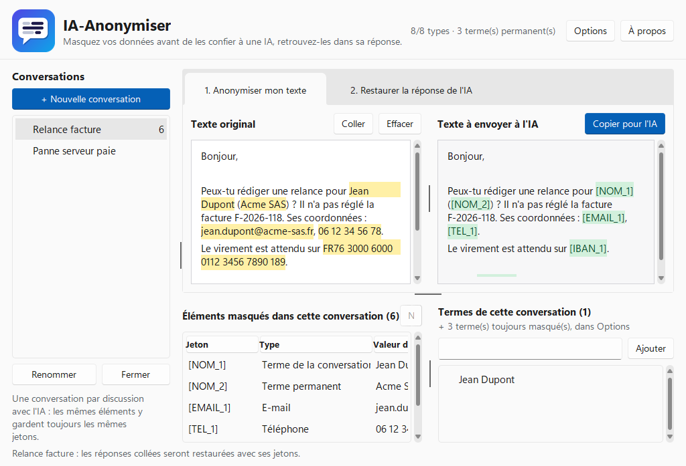
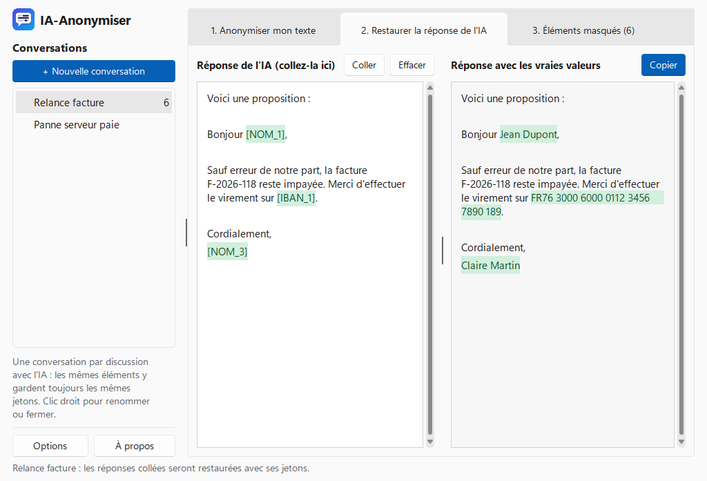
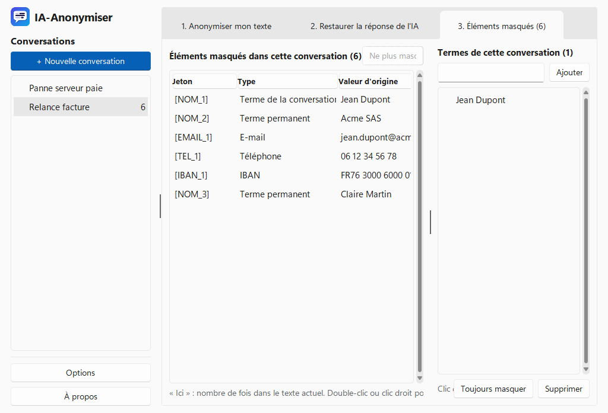
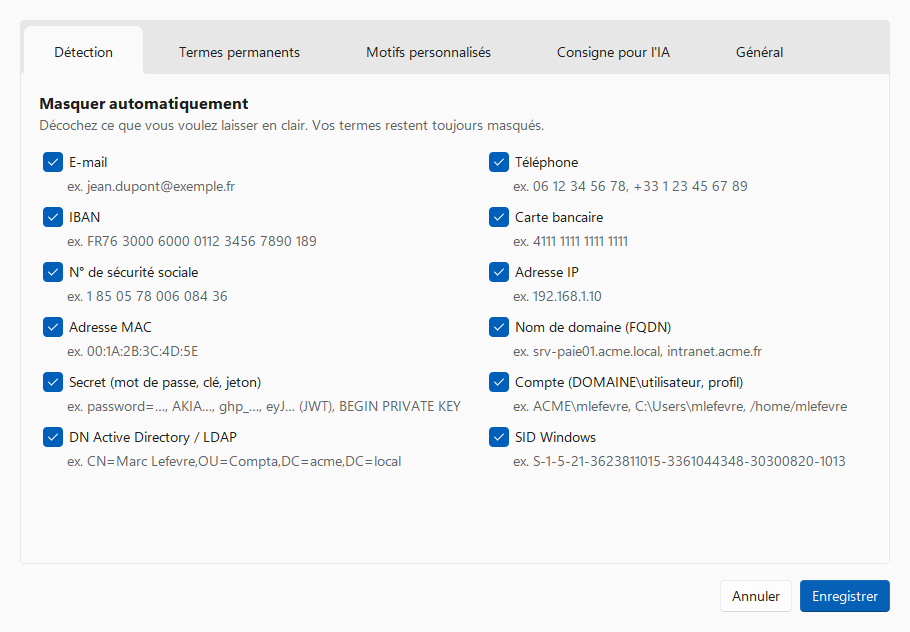
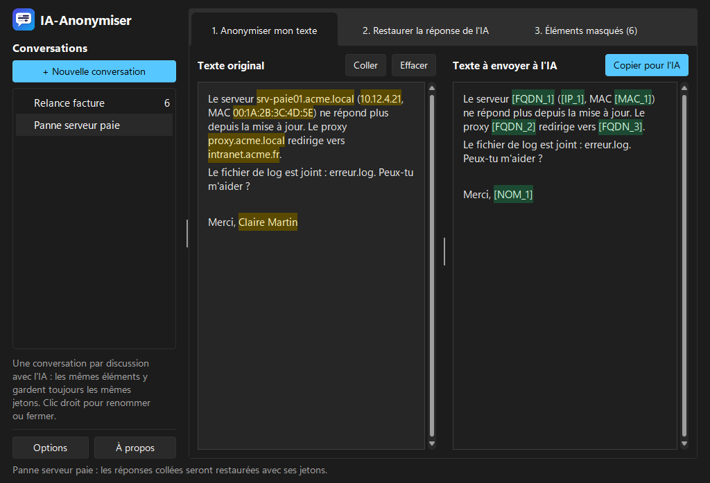

# IA-Anonymiser

Masquez vos données personnelles avant de les envoyer à une IA (Claude, ChatGPT…), puis remettez les vraies valeurs dans sa réponse, en un clic. En français et en anglais, avec un thème clair ou sombre.



## Télécharger

Téléchargez **[IA-Anonymiser.exe](https://github.com/Some0neElseIsHere/IA-Anonymiser/releases/latest/download/IA-Anonymiser.exe)**, la dernière version. Aucune installation n'est nécessaire : lancez simplement le fichier.

Les nouveautés de chaque version sont détaillées dans les [notes de version](docs/release-notes.md).

Chaque [release](https://github.com/Some0neElseIsHere/IA-Anonymiser/releases) contient deux fois le même programme : `IA-Anonymiser.exe`, dont le lien ci-dessus mène toujours à la dernière version, et `IA-Anonymiser-vX.Y.Z.exe`, qui porte son numéro de version.

> Au premier lancement, Windows peut afficher « Windows a protégé votre ordinateur », car l'exe n'est pas signé. Cliquez sur **Informations complémentaires**, puis **Exécuter quand même**.

## Utilisation

Au premier lancement, un écran d'accueil présente le principe. Ensuite, tant qu'une zone de texte est vide, elle affiche les étapes à suivre.

1. **Onglet « Anonymiser mon texte »** : collez votre texte à gauche. La version anonymisée apparaît aussitôt à droite. Les éléments masqués sont surlignés en jaune.
2. Cliquez sur **Copier pour l'IA** et collez le texte dans votre conversation.
3. **Onglet « Restaurer la réponse de l'IA »** : collez la réponse de l'IA à gauche. À droite, les jetons comme `[NOM_1]` sont remplacés par les vraies valeurs. Cliquez sur **Copier**.

Dans les deux onglets, **passez la souris sur un élément surligné** : une bulle affiche le jeton correspondant (côté texte original ou réponse restaurée) ou la vraie valeur (côté jetons), avec son type. La ligne survolée s'éclaire **des deux côtés**, pour retrouver d'un coup d'œil sa version anonymisée ou restaurée. Les deux zones **défilent ensemble**, ligne à ligne.

Pour **rechercher** dans le texte original : **Ctrl+F** ou la loupe à côté de « Coller ». Toutes les occurrences sont surlignées en bleu, la courante en orange ; **Entrée** passe à la suivante, **Maj+Entrée** à la précédente, **Échap** ferme la recherche. La zone de droite suit, pour voir la version anonymisée.



### Une conversation par discussion avec l'IA

La colonne de gauche liste vos conversations, classées comme dans Claude : d'abord les **épinglées**, puis **Aujourd'hui**, **Hier**, et une rubrique par date (« 9 nov. »), selon votre dernière activité dans chacune. Créez-en une par discussion avec l'IA. Dans une conversation, un même élément garde toujours le même jeton, d'un message à l'autre : si Jean Dupont est `[NOM_1]` dans votre premier message, il le reste dans les suivants, et l'IA s'y retrouve. L'onglet **3. Éléments masqués** liste tous les éléments déjà masqués dans la conversation, y compris ceux des messages précédents. Cliquez sur un en-tête de colonne (Jeton, Type, Valeur d'origine, Ici) pour trier : un clic par ordre croissant ▲, un deuxième par ordre décroissant ▼, un troisième pour revenir à l'ordre d'apparition dans le texte. Le tri ignore majuscules et accents, et range les nombres dans l'ordre naturel (`[IP_2]` avant `[IP_10]`). Il est conservé d'un lancement à l'autre.

**Avant de coller une réponse de l'IA, sélectionnez la bonne conversation.** Un jeton inconnu de cette conversation apparaît en rouge.

Les conversations sont conservées d'un lancement à l'autre : vous pouvez restaurer une réponse de l'IA le lendemain. Faites un clic droit sur une conversation pour l'épingler, la renommer ou la fermer. Le bouton **«** à côté du titre réduit la colonne à une barre d'icônes : déplier, nouvelle conversation, vos conversations en initiales (« IA » pour « Incident AD », nom complet au survol, clic droit pour le menu), Options et À propos pour laisser plus de place au texte ; **»** la déplie. Ce choix est conservé.

### Ce qui est masqué

- **Automatiquement** :
  - données personnelles : e-mails, téléphones (France et international), IBAN, cartes bancaires, numéros de sécurité sociale ;
  - réseau : adresses IP, IPv4 et IPv6, en deux types distincts : **locales** `[IP_1]` (10.x, 172.16–31.x, 192.168.x, 100.64.x, 169.254.x, fc00::/7, fe80::…) et **publiques** `[IP_PUB_1]` (toutes les autres), pour que l'IA distingue l'interne d'Internet. Chacun peut être décoché, par exemple pour laisser lisible l'IP publique d'un attaquant. `127.0.0.1` et `::1` restent en clair ; adresses MAC, noms de domaine (`srv01.acme.local`) et noms de machine là où leur place est certaine : en-tête syslog, champs des événements Windows (« Workstation Name », « Account Domain »…), comptes d'ordinateur `PC-0815$`, `ipconfig /all`, `systeminfo`, `hostnamectl`, chemins réseau `\\fs01\partage` ;
  - **secrets** : `password=…`, `pwd:`, `token=`, `api_key=`, chaînes de connexion, `Authorization: Bearer …`, identifiants dans une URL (`https://user:motdepasse@…`), mot de passe de `net use`, clés AWS, GitHub, GitLab, Slack, OpenAI, Anthropic et Google, jetons JWT, clés privées. Seule la valeur est masquée (`password=[SECRET_1]`), pour que l'IA comprenne encore de quoi il s'agit ;
  - **comptes et annuaire** : `ACME\mlefevre`, `User Id=…`, `login=…`, le compte dans une URL (`https://deploy:…@`), le nom d'utilisateur dans `C:\Users\…` et `/home/…`, les comptes des journaux SQL Server (`Login failed for user '…'`), SSH, PAM, sudo, systemd, auditd, des journaux d'accès web, de `net user`, et les champs « Account Name » des événements Windows ; les SID Windows. Un compte `DOMAINE\utilisateur` rend aussi le domaine et l'utilisateur reconnaissables ailleurs (sortie de `whoami` en minuscules, par exemple) ;
  - les numéros de carte, d'IBAN et de sécurité sociale écrits sans espaces doivent avoir une clé de contrôle valide (Luhn, modulo 97, clé du NIR) : les empreintes MD5, GUID et adresses mémoire des journaux ne sont plus pris pour des numéros. Écrits avec leurs espaces, comme dans un mail, ils sont toujours masqués ;
  - **DN Active Directory**, masqués partie par partie : `CN=Sophie Bernard,OU=Compta,DC=acme,DC=local` devient `CN=[NOM_3],OU=Compta,[DN_1]`. Le nom garde le même jeton qu'ailleurs dans la conversation, donc l'IA sait de qui il s'agit ; l'OU reste lisible.
- **Une valeur déjà masquée l'est partout** : si `slefevre` a été masqué dans un chemin, il l'est aussi dans « user slefevre », et un mot de passe recopié plus tard dans une phrase est masqué lui aussi.
- **Masquage personnalisé** (dans **Options**) : ce que vous voulez toujours masquer, dans toutes les conversations. Une seule liste, deux façons de saisir :
  - **texte exact** : le nom de votre entreprise, de vos clients, de vos collègues… (majuscules et accents ignorés). Vous pouvez donner à chacun un **jeton parlant**, par exemple `[ENTREPRISE]` ou `[CLIENT_PRINCIPAL]` au lieu de `[NOM_1]`, pour que l'IA comprenne de quoi il s'agit. Si vous changez le jeton d'un terme déjà envoyé dans une conversation, la copie suivante prévient l'IA : « Changement de jeton : [NOM_1] s'appelle désormais [ENTREPRISE]. C'est le même élément. » Les anciennes réponses restent restaurées ;
  - **expression régulière** (case à cocher) : vos conventions de nommage, pour toute une famille de valeurs. Par exemple `PC-\d{4}` pour les postes, `INC-\d{4}-\d+` pour les tickets, `SRV-[A-Z]+\d*` pour les serveurs. Chaque valeur trouvée reçoit son propre jeton (`[REF_1]`, `[REF_2]`…), et le titre facultatif (« Postes de travail ») apparaît comme type dans la liste des éléments masqués et dans le rapport.
- **Termes de la conversation** : un nom qui ne concerne que cette discussion. Ajoutez-le dans l'onglet **3. Éléments masqués**, ou sélectionnez-le dans le texte puis clic droit → **Masquer** (ou **Ctrl+M**). Le bouton **Toujours masquer** en fait un terme permanent.

Ce qui reste volontairement en clair : les noms de fichiers (`rapport.pdf`, `backup.tar.gz`), les numéros de version, les noms de classes et les clés de configuration (`java.lang.NullPointerException`, `spring.datasource.url`), les comptes système (`NT AUTHORITY\SYSTEM`, `BUILTIN\Administrators`), les chemins de registre (`HKLM\…`) et les SID système (`S-1-5-18`).



Pour laisser un élément en clair, faites un clic droit dessus → **Ne pas masquer**. Ça marche dans les trois onglets : sur la valeur surlignée dans votre texte, sur un jeton, ou sur une ligne du tableau des éléments masqués. Le même clic droit permet de le masquer à nouveau.

### Rapport de preuve

Pour garder une trace de ce qui a été envoyé à l'IA, cliquez sur **Exporter le rapport…** dans l'onglet **3. Éléments masqués**, ou faites un clic droit sur la conversation. Le rapport est une page HTML, lisible dans un navigateur et imprimable en PDF. Il contient :

- la date de l'export, le compte Windows qui l'a généré (`DOMAINE\utilisateur`) et la version de l'application ;
- la conversation et les réglages actifs (types détectés, nombre de termes et de motifs) ;
- chaque élément masqué : jeton, **valeur d'origine**, type, et s'il a été masqué ou laissé en clair volontairement ;
- le texte exact de chaque envoi à l'IA, tel qu'il est parti (anonymisé), avec sa date et son empreinte SHA-256 ;
- **les valeurs parties en clair par erreur** : chaque envoi est vérifié, et une valeur retrouvée en clair est signalée en rouge, avec le numéro de l'envoi (par exemple un terme ajouté après coup, ou un envoi fait avec une ancienne version).

**C'est un document confidentiel** : il réunit les valeurs d'origine de la conversation (noms, adresses, secrets…). Conservez-le dans un emplacement sécurisé. Les envois sont enregistrés à chaque « Copier pour l'IA » (ou copie depuis le texte à envoyer), à partir de la version 1.6.

## Options



- **Détection** : cochez les types de données à masquer automatiquement.
- **Masquage personnalisé** : la liste des termes et motifs toujours masqués. Saisissez le terme ou le motif, cochez **Expression régulière** pour un motif, puis donnez si vous le souhaitez un jeton (texte exact) ou un titre (expression régulière). L'icône ⓘ à côté de la case rappelle la syntaxe. En ajoutant un motif, vous voyez combien de fois il apparaît dans le texte en cours. Cliquez sur une ligne pour la modifier.

  Les motifs utilisent le moteur d'expressions régulières de **Python** (module `re`), très proche de PCRE, de JavaScript et de .NET. Un motif testé dans PowerShell avec `'PC-0815' -match 'PC-\d{4}'` fonctionne donc ici, y compris la syntaxe .NET `(?<v>…)` pour ne masquer qu'une partie. La casse est ignorée.
- **Consigne pour l'IA** : un texte ajouté au début de ce que vous copiez, qui demande à l'IA de garder les jetons tels quels. Vous pouvez le modifier, le désactiver ou rétablir le texte par défaut.
- **Général** :
  - la langue (automatique, français ou anglais) ;
  - le thème (automatique comme Windows, clair ou sombre) ;
  - la conservation des conversations après la fermeture.

En anglais, les jetons sont aussi traduits : `[NAME_1]`, `[PHONE_1]`, `[CARD_1]`… Les deux formes sont reconnues lors de la restauration.



## Confidentialité

- Tout se passe sur votre ordinateur : vos textes ne sont envoyés nulle part. Seul le bouton **Rechercher une nouvelle version**, dans À propos, contacte GitHub, et uniquement pour connaître le numéro de la dernière version.
- Les options et les termes permanents sont enregistrés dans `%APPDATA%\IA-Anonymiser\options.json`.
- Les conversations, qui contiennent les vraies valeurs, sont enregistrées dans `%APPDATA%\IA-Anonymiser\conversations.dat`, **chiffrées avec votre compte Windows** (DPAPI). Un autre compte, ou une copie du fichier sur un autre ordinateur, ne peut pas les lire. Vous pouvez désactiver cette conservation, ou effacer le fichier, dans **Options → Général**.

## Limites

La détection repose sur des motifs : elle ne peut pas être parfaite.

- Un nom de personne n'est masqué que s'il figure dans vos termes. Une adresse postale doit aussi être ajoutée comme terme.
- Un nom de machine sans point (`SRV-PAIE01`) n'est masqué que par un motif personnalisé.
- Un mot de passe n'est reconnu que s'il a une forme reconnaissable (`password=…`, une clé connue…). Écrit seul au milieu d'une phrase, il ne se distingue pas d'un mot ordinaire.
- À l'inverse, un élément peut être masqué à tort : faites un clic droit → **Ne pas masquer** pour le laisser en clair. **Relisez toujours le texte de droite avant de l'envoyer.**

## Vérifier le téléchargement

Chaque release contient un fichier `SHA256SUMS.txt`. Dans PowerShell :

```
Get-FileHash .\IA-Anonymiser.exe -Algorithm SHA256
```

L'empreinte affichée doit correspondre à celle indiquée dans le fichier, qui contient les deux exe.

## Publier une nouvelle version

Ajoutez d'abord les nouveautés en tête de [docs/release-notes.md](docs/release-notes.md) (une entrée `- **vX.Y.Z** : …`) : sans elle, la publication est refusée. Ensuite, dans l'onglet **Actions**, ouvrez **Construction et release**, cliquez sur **Run workflow** et saisissez le numéro de version (par exemple `v1.4.0`). Les tests sont lancés, puis l'exe est compilé et publié dans une release.

## Licence

GNU GPL v3. IA-Anonymiser utilise Python (licence PSF), Tcl/Tk (licence BSD) et le thème [Sun Valley](https://github.com/rdbende/Sun-Valley-ttk-theme) (licence MIT).
