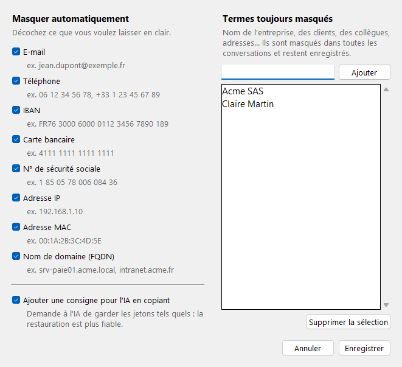

# IA-Anonymiser

Masquez vos données personnelles avant de les envoyer à une IA (Claude, ChatGPT…), puis remettez les vraies valeurs dans sa réponse, en un clic.


## Télécharger

Téléchargez **IA-Anonymiser.exe** dans la [dernière release](https://github.com/Some0neElseIsHere/IA-Anonymiser/releases/latest). Aucune installation n'est nécessaire : lancez simplement le fichier.

> Au premier lancement, Windows peut afficher « Windows a protégé votre ordinateur », car l'exe n'est pas signé. Cliquez sur **Informations complémentaires**, puis **Exécuter quand même**.

## Utilisation

1. **Onglet « Anonymiser mon texte »** : collez votre texte à gauche. La version anonymisée apparaît aussitôt à droite. Les éléments masqués sont surlignés en jaune.
2. Cliquez sur **Copier pour l'IA** et collez le texte dans votre conversation.
3. **Onglet « Restaurer la réponse de l'IA »** : collez la réponse de l'IA à gauche. À droite, les jetons comme `[NOM_1]` sont remplacés par les vraies valeurs. Cliquez sur **Copier**.


### Plusieurs conversations

La colonne de gauche liste vos conversations. Créez-en une par discussion avec l'IA : chacune garde ses propres jetons, donc `[NOM_1]` peut désigner une personne différente dans deux conversations. **Avant de coller une réponse de l'IA, sélectionnez la bonne conversation.** Double-cliquez sur une conversation pour la renommer.

### Ce qui est masqué

- **Automatiquement** : e-mails, téléphones (France et international), IBAN, cartes bancaires, numéros de sécurité sociale, adresses IP, adresses MAC, noms de domaine (FQDN, par exemple `srv01.acme.local`). Les noms de fichiers comme `rapport.pdf` ne sont pas pris pour des domaines.
- **Termes toujours masqués** : le nom de votre entreprise, de vos clients, de vos collègues… Ils se règlent dans **Options**, sont enregistrés et s'appliquent à toutes les conversations.
- **Termes de la conversation** : un nom qui ne concerne que cette discussion. Ajoutez-le dans le panneau du bas, ou sélectionnez-le dans le texte puis clic droit → **Masquer** (ou **Ctrl+M**). Le bouton **Toujours masquer** le fait passer dans les termes permanents.

Le tableau « Éléments masqués » montre chaque élément remplacé. Double-cliquez sur une ligne pour le laisser en clair, ou pour le masquer à nouveau.

### Options



- **Masquer automatiquement** : cochez les types de données à détecter. Les termes sont toujours masqués, même si un type est décoché.
- **Termes toujours masqués** : voir plus haut.
- **Ajouter une consigne pour l'IA en copiant** : ajoute une phrase demandant à l'IA de garder les jetons tels quels. Elle est activée par défaut, ce qui rend la restauration plus fiable.

Dans la barre du haut, le **mode automatique du presse-papiers** anonymise tout texte que vous copiez et restaure toute réponse contenant des jetons, avec la conversation sélectionnée. Attention : il s'applique à *tout* ce que vous copiez tant qu'il est activé.

## Confidentialité

- Tout se passe sur votre ordinateur : l'application n'envoie rien sur Internet.
- Les correspondances entre jetons et vraies valeurs restent en mémoire et disparaissent à la fermeture, ou quand vous fermez une conversation. Gardez l'application ouverte pendant toute la discussion avec l'IA.
- Seules les options et les termes toujours masqués sont enregistrés, dans `%APPDATA%\IA-Anonymiser\options.json`.

## Limites

La détection repose sur des motifs. Elle ne reconnaît pas un nom qui ne figure pas dans vos termes, une adresse postale doit être ajoutée comme terme, et un nom de machine sans point (`SRV-PAIE01`) aussi. À l'inverse, la détection des FQDN peut masquer des mots comme `ASP.NET` : double-cliquez sur la ligne pour les laisser en clair. **Relisez toujours le texte de droite avant de l'envoyer.**

Si l'IA modifie un jeton au point de le rendre méconnaissable, ou si elle en invente un, il reste tel quel et apparaît en rouge dans l'onglet Restaurer.

## Vérifier le téléchargement

Chaque release contient un fichier `SHA256SUMS.txt`. Dans PowerShell :

```
Get-FileHash .\IA-Anonymiser.exe -Algorithm SHA256
```

L'empreinte affichée doit correspondre à celle du fichier.

## Publier une nouvelle version

Dans l'onglet **Actions**, ouvrez **Construction et release**, cliquez sur **Run workflow** et saisissez le numéro de version (par exemple `v1.2.0`). Les tests sont lancés, puis l'exe est compilé et publié dans une release.
